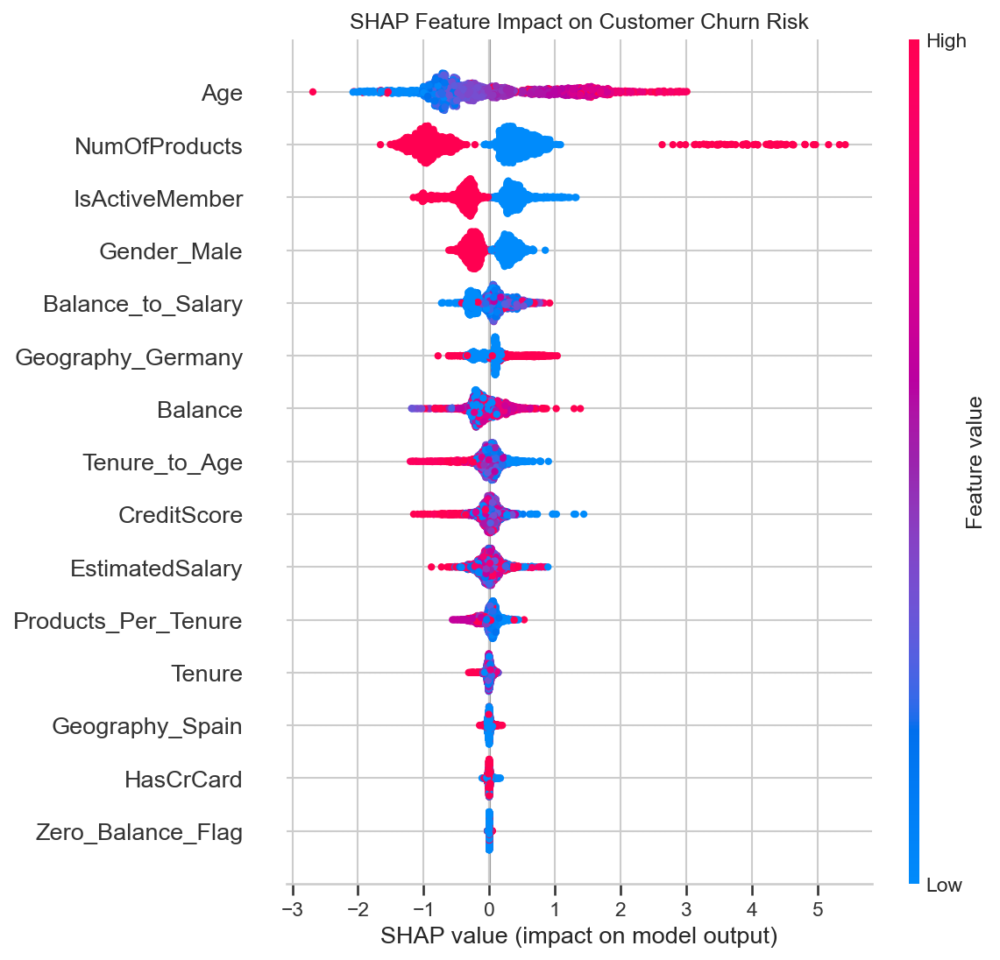

# 🏦 Bank Customer Churn Prediction & SHAP Explainability

An end-to-end machine learning pipeline predicting retail banking customer attrition and generating individual SHAP risk drivers for relationship managers.

## 📌 Business Problem & Key Insights
Acquiring a new banking customer costs significantly more than retaining an existing depositor. Exploratory data analysis and SHAP modeling on 10,000 customer records revealed:
- **Product Bundling Cliff:** Customers with **2 products** have the lowest churn (~7.5%), whereas holding **3–4 products** spikes churn above **80%**.
- **Regional Attrition:** Customers in **Germany** churn at roughly **2x** the rate of France and Spain (~32% vs. ~16%).
- **Engagement & Demographics:** Inactive members churn at nearly double the rate of active members, with peak risk concentrated among depositors aged **40–60**.

## 🛠️ Tech Stack & Architecture
- **Modeling:** `LightGBM` vs. `Logistic Regression` baseline (`scikit-learn`)
- **Feature Engineering:** Domain financial ratios (`Balance_to_Salary`, `Tenure_to_Age`, `Products_Per_Tenure`, `Zero_Balance_Flag`)
- **Explainability:** `SHAP` (TreeExplainer global beeswarm + local per-customer drivers)
- **Web App:** `Streamlit`



## 🚀 Run Locally
```bash
git clone [https://github.com/YOUR_USERNAME/bank-customer-churn-ml.git](https://github.com/YOUR_USERNAME/bank-customer-churn-ml.git)
cd bank-customer-churn-ml
pip install -r requirements.txt
streamlit run app.py